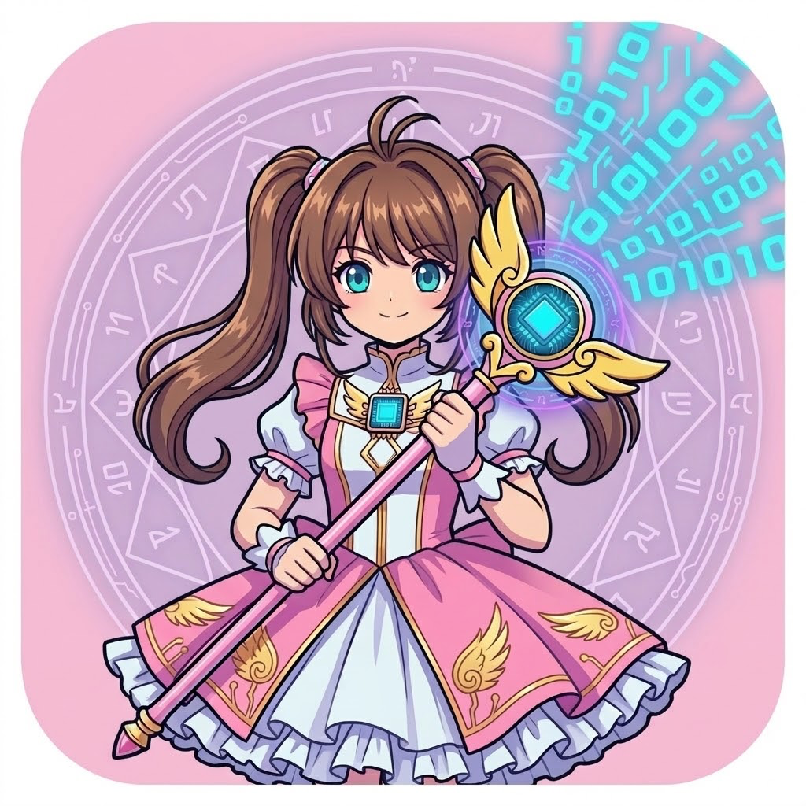
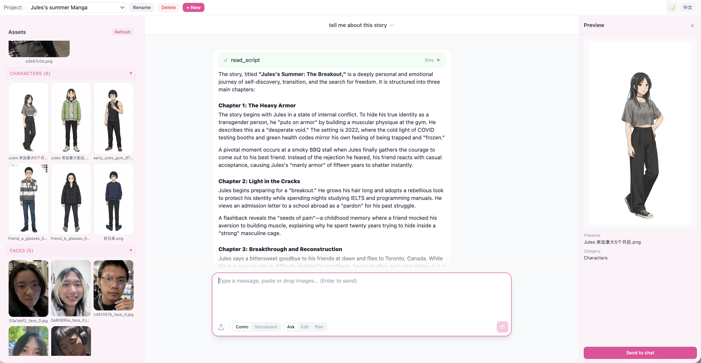
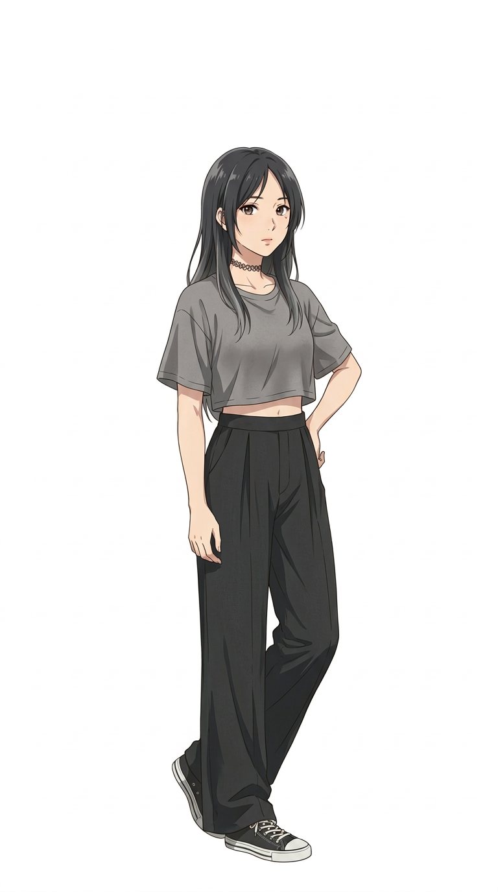
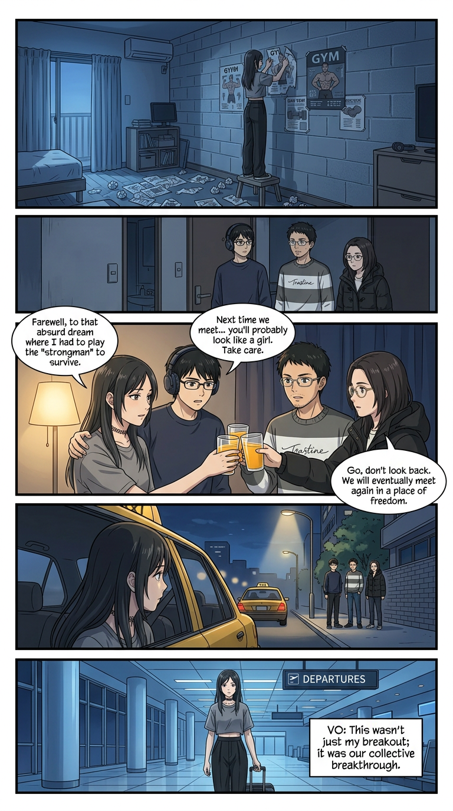
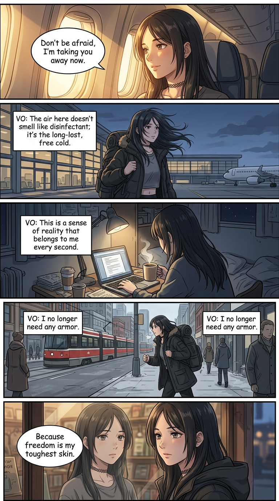
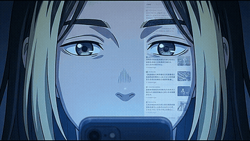

<p align="center">
  
</p>

<h1 align="center">Animegent</h1>

<p align="center">
  Your personal AI anime studio.<br/>
  Photos to manga and animation in one conversation.
</p>

<p align="center">
  
  
</p>

<p align="center">
  <a href="https://www.youtube.com/watch?v=OhFAgBwdZ2s">
    
  </a>
  <br/>
  <a href="https://www.youtube.com/watch?v=OhFAgBwdZ2s">Watch Demo Video</a>
</p>

---

## What is Animegent?

Animegent turns ordinary photographs into anime-style comic strips and animated short videos through a conversational AI agent.

Upload a photo of your friends, your family, your community. Animegent detects each face, transforms everyone into an anime character that looks like *them*, writes a story, and generates a complete manga page or animated video. The same person keeps their consistent anime identity across every panel, every scene, and every animation.

You don't draw. You don't write prompts. You just talk to Animegent like a creative partner.

## Screenshots

<p align="center">
  
  <br/><em>Chat with Animegent to create your story</em>
</p>

<p align="center">
  
  <br/><em>Photo to anime character with preserved identity</em>
</p>

<p align="center">
  
  
  <br/><em>AI-generated multi-panel manga</em>
</p>

<p align="center">
  
  
  
  <br/><em>Generated animation clips</em>
</p>

## Features

- **Photo to Anime Character**: face detection + full-body anime stylization that preserves hairstyle, outfit, and identity
- **Comic Strip Generation**: AI writes scripts and generates multi-panel vertical manga
- **Strip Drafts**: strips are planned the way Japanese manga is made (plot → ネーム storyboard → drawing → editor's check). A master script says what happens; each strip then gets its own storyboard draft with the panel layout, camera, composition, acting and text placement, and a layout sketch drawn in code (slanted cuts, round insets, borderless bleeds…). The draft is checked against an editor's checklist and revised, the image model draws from it, and the finished strip is checked against the draft
- **Fix Instead of Redraw**: after a strip is checked, local problems (a hand, a prop, hair under a hat, a wrong word, panel proportions) are fixed in place: the assistant sends the image model the strip, a copy with a coordinate grid and numbered red boxes, and whatever else the fix needs (the layout sketch, a panel to match, character references). Only the boxed areas are pasted back, so the rest of the strip stays pixel-identical
- **Skills**: the long how-to guides (master script, strip drafts, panel layout, layout sketches, checking finished strips, fixing, storyboard videos) live as Markdown skills in `skills/`. The assistant only sees a catalog and reads a skill when the task calls for it; a project can override any skill with its own copy
- **Animation** *(dormant for now)*: storyboard frames to animated video clips with voice acting, auto-merged into a final short. The code is kept but the storyboard / video mode is hidden; start with `ANIMEGENT_STORYBOARD=1 ./run.sh` to turn it back on
- **Character Consistency**: same person recognized across photos via face-embedding clustering
- **Human-in-the-Loop**: image generation waits for your approval (or runs automatically), runs in the background, and every step streams live
- **Bilingual**: full Chinese and English support

## Quick Start

### Prerequisites

- Python 3.11+ with [uv](https://github.com/astral-sh/uv)
- Node.js 20+
- An API key for your model provider(s): any OpenAI-compatible API, Google Gemini, or Anthropic
- Optional: [Deno](https://deno.com) (`brew install deno`), for the panel layout sketches. The agent's drawing code runs in a sandbox: Python (Pillow) compiled to WebAssembly ([Pyodide](https://pyodide.org)), inside Deno with no permissions except reading Pyodide's own files, so it cannot read or write your files, use the network or run commands. Pyodide (~8 MB) is downloaded to `.cache/` on first use

### Setup

```bash
# Clone
git clone https://github.com/your-username/animegent.git
cd animegent

# One command: installs dependencies on first run, starts backend + frontend,
# opens the browser; Ctrl+C stops both
./run.sh

# Optional: other ports, or don't open the browser
FRONTEND_PORT=3000 BACKEND_PORT=8100 NO_BROWSER=1 ./run.sh

# Optional: enable the dormant storyboard / video mode
ANIMEGENT_STORYBOARD=1 ./run.sh
```

Or start the two parts manually:

```bash
# Backend
uv sync
uv run uvicorn src.web.api:app --reload --port 8000

# Frontend (the dev server proxies /api and /files to the backend;
# set ANIMEGENT_BACKEND=http://127.0.0.1:<port> if the backend isn't on 8000)
cd web/frontend
npm install
npm run dev
```

Open http://localhost:5173 in your browser, then click **⚙ API Settings** in the top-right corner.

### API Configuration

All model APIs are configured in the app and saved to `settings.json` in the project root (git-ignored):

1. **Providers**: add one or more API providers, each with an API format (OpenAI-compatible / Google Gemini / Anthropic), a base URL and one or more API keys (rotated round-robin). You can fetch each provider's model list and test the connection from the form.
2. **Models**: choose a provider and model for each role:

| Role | Used for | Supported APIs |
|------|----------|----------------|
| Chat | The agent (needs function calling) | OpenAI-compatible, Gemini, Anthropic |
| Vision | Asset naming/description, scene analysis (falls back to Chat) | OpenAI-compatible, Gemini, Anthropic |
| Image | Character stylization, comics, storyboard frames, scenes | Gemini `generateContent`, OpenAI Images API |
| Video | Storyboard clips (only shown when the storyboard mode is enabled) | Unified `/v1/video/create` (yunwu, New API, …), OpenAI Sora, Google Veo |

If `settings.json` doesn't exist yet, legacy `API_KEYS` / `BASE_URL` values from `.env` are imported automatically as a Gemini-format provider.

## Architecture

```
                    ┌─────────────┐
                    │   Frontend   │
                    │  React+Vite  │
                    └──────┬───────┘
                           │ SSE
                    ┌──────▼───────┐
                    │   FastAPI    │
                    │   Backend    │
                    └──────┬───────┘
                           │
                    ┌──────▼───────┐
                    │  LLM Agent   │
                    │  15+ Tools   │
                    └──────┬───────┘
                           │
          ┌────────────────┼────────────────┐
          │                │                │
   ┌──────▼──────┐  ┌─────▼──────┐  ┌──────▼──────┐
   │  InsightFace │  │  Image /   │  │  Vision     │
   │  Face Detect │  │  Video Gen │  │  LLM        │
   └─────────────┘  └────────────┘  └─────────────┘
```

- **Backend**: FastAPI + LLM function calling (SSE streaming agent pattern)
- **Frontend**: React + TypeScript + Vite + Tailwind CSS v3
- **AI Models**: configured per role in the UI (chat / vision / image / video); see `src/providers/`
- **Face Detection**: InsightFace (buffalo_l, local CPU)
- **Database**: SQLite with WAL mode for conversation persistence

## How It Works

1. **Upload photos** and Animegent detects every face
2. **Select faces** to stylize into full-body anime characters
3. **Describe your story** in natural language
4. **AI works step by step**: writing the master script, drafting each strip (layout, camera, acting, text), generating panels in the background, and checking each strip against its draft
5. **Review and refine** at every step with human-in-the-loop controls

Each message you send is a *turn*. Inside it, every piece of the assistant's reply and every tool call is a *step*:

- Pick a mode in the composer: **Ask** (chat and read only, nothing is generated), **Confirm** (image generation waits for your approval, everything else runs directly), or **Auto** (runs everything without asking).
- Image generation runs in the background: the assistant starts it, keeps working, and checks the results (`check_jobs`) when it needs them. Several images generate at once, one per API key.
- Choosing characters or faces happens in a card, and your choice goes straight back to the assistant.
- Each strip's storyboard draft is written by its own model calls (`draft_strip`): draft, sketch the layout, check against the checklist, revise. Only a summary and the sketch come back to the conversation, so long works don't flood the assistant's memory. Drafts are saved to `output/scripts/strips/` (you can edit them in the asset sidebar before generating) and sketches with their code to `output/layouts/`.
- Layout sketches are drawn with Python + Pillow in the WebAssembly sandbox. The assistant sees each sketch and fixes it if something is off.
- After a strip is generated, `review_comic_strip` compares it with its draft panel by panel and says whether it is fine, has minor issues, or should be redrawn. Each problem comes with its panel, a grid location (columns A–F × rows 1–10, e.g. `C4:D6`) and how to fix it.
- Strips are read as a sequence too: after a group of drafts is written, and again after the strips are generated, `read_through` reads them in order as a first-time reader, retells the story it got and lists what a reader would trip over (a character never introduced, a term never explained, a time jump with no cue, layouts repeating), with the root in the master script, the draft or the image.
- The assistant then follows the `strip-fix` skill: check → fix (`fix_comic_strip`) → check again. Only problems that would make a reader misread, break continuity, lose the emotional beat or misspell text get fixed; at most 4 places per fix and two fixes per strip unless you ask for more. A fix lists the places to change (panel and/or grid area, the correct text, what it should look like) plus optional references: the layout sketch to restore panel proportions, panels cropped from the strip for continuity, character or scene images. Every fix is saved as a new version (`strip_3_fix1.png`); the original is kept.
- Detailed guides are **skills** (`skills/<id>/SKILL.md`, the same format as PetGPT's Skills): YAML frontmatter with `name`, `description`, optional `version` and `scopes` (`comic` / `storyboard`), then the instructions; other files in the folder are references.
  - The system prompt carries only the catalog. The assistant loads a skill with `skill_load` and its files with `skill_read_resource`; both are read-only.
  - `draft_strip` and `review_comic_strip` build their prompts from the `strip-draft`, `layout-sketch` and `strip-review` skills, so editing a skill changes how drafts are written and checked.
  - To customize a skill for one project, put a copy at `projects/<name>/skills/<id>/SKILL.md`. The project copy wins over the built-in one, is editable in the asset sidebar (built-in skills are read-only there), and an invalid copy falls back to the built-in skill.
- You can stop at any time. Images that are already generating still finish; queued ones are cancelled.
- Retry, edit and delete rewind the assistant's memory as well, so the conversation stays consistent. Everything is stored by the backend, so reloading the page or restarting the server loses nothing.

## Project Structure

```
src/
  web/
    api.py              # FastAPI routes, SSE chat endpoint
    agent/              # Agent: session → turn → step loop, tool registry, background jobs, prompts
    db.py               # SQLite: conversations, turns, steps, model history, background jobs
  providers/            # Provider layer: settings, LLM adapters, image & video APIs
  tools/                # Face detection, stylization, image/video gen, PIL sandbox
  mcp_tools/            # MCP tool definitions for external clients
web/frontend/src/
  components/           # React components
  api.ts                # SSE parser, API client
  i18n.ts               # Bilingual translations (zh/en)
skills/{id}/SKILL.md    # Built-in skills: master-script, strip-draft (+ template, checklist, sources), panel-layout, layout-sketch, strip-review, strip-fix, read-through, storyboard-video
projects/{name}/        # Per-project asset storage
  input/                # Uploaded photos
  output/               # Generated assets
  skills/               # Optional project skills (override built-in ones with the same id)
  style.md              # Project style guide (zh)
  style_en.md           # Project style guide (en)
```

## Tech Stack

| Layer | Technology |
|-------|-----------|
| AI | Any OpenAI-compatible / Google Gemini / Anthropic API, configured in-app |
| Backend | Python, FastAPI, SQLite |
| Frontend | React, TypeScript, Vite, Tailwind CSS |
| Face Detection | InsightFace (buffalo_l) |
| Video | FFmpeg |
| Interop | Model Context Protocol (MCP) |

## License

MIT

---

<p align="center">
  Built for <strong>GenAI Genesis 2026</strong>
</p>
